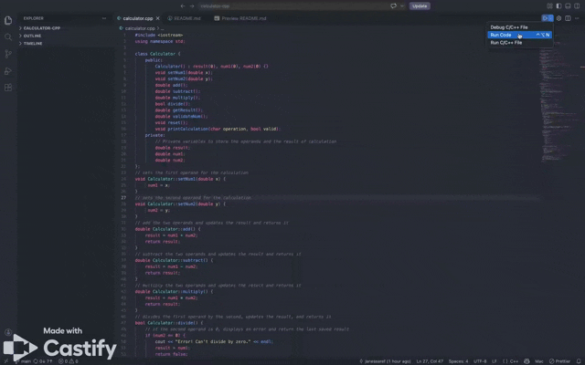

# C++ Calculator

## Table of Contents
* [Description](#description)
* [Features](#features)
* [Build and Run](#build-and-run)
* [Usage](#usage)
* [GIFs of Project](#gifs-of-project)
* [Code Snippet](#code-snippet)
* [Future Work](#future-work)
* [Authors](#authors)

## Description

A command-line calculator written in C++. Functionality works like a real calculator by keeping the running total so that it builds on the previous calculated result until you reset the calculator. 

This application was a final project for COMSC-165 class at Diablo Valley College. We were given the option to freely choose our own project for the final, and I built this calculator from scratch.

## Features

 * Basic operations include addition, subtraction, multiplication and division on whole or decimal numbers
 * Running total: the result of each operation becomes the first number of the next one
 * Reset (r) to return and set the calculator to zero and start over
 * Quit (q) to end the application
 * Input validation: non-numeric input is rejected and the program prompts "Invalid input. Please enter a valid number: "
 * Operation validation: any menu choice other than `+`, `-`, `*`, `/`, `r`, or `q` is rejected and the program prompts "Invalid operation. Please try again."
 * Division by zero: prints "Undefined" and resets the calculator 

## Build and Run

A C++ compiler such as `g++` is needed. From the project folder, compile and run the program:

```bash
g++ -std=c++17 -Wall -Wextra -o calculator calculator.cpp
./calculator
```

## Usage

1. Enter a first number.
2. Choose an operation: `+`, `-`, `*`, or `/`.
3. Enter a second number. The program then prints the equation and current result. The current result becomes the first number for the next operation.
4. At the operations menu, type `r` to reset or `q` to quit.

## GIFs of Project

Below is a GIF of the application.


<br>
[Watch Full Demo Video Here](https://app.screencastify.com/watch/3Vh5FJXGQmFm0rthDClX)


## Code Snippet

In this code snippet, the function handles the division. If the second operand is zero, it prints the error message and returns false, and the program prints "Undefined" as the result and resets the calculator. Otherwise, it divides the two inputs, sets the result, and returns true. 

```cpp
// divides the first operand by the second and updates the result; returns false if dividing by zero, true otherwise
bool Calculator::divide() {
    // if the second operand is 0, displays an error and returns false without dividing
    if (num2 == 0) {
        cout << "Error! Can't divide by zero." << endl;
        return false;
    }
    result = num1 / num2;
    return true;
} 
```

## Future Work

* Add more operations such as square root, percentage, and pi
* Add trigonometric functions, moving towards a scientific calculator
* Let the user type a full expression to evaluate, for example: (5+2)*3^2
* Graph or visually show equations

## Authors

Janessa Fong

